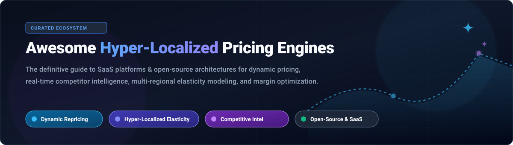

<div align="center">



# ⚡ Awesome Hyper-Localized E-Commerce Pricing Engines 🛒

<a href="https://github.com/ishandutta2007/Awesome-Awesome-Awesome"></a><a href="https://discord.gg/jc4xtF58Ve"></a>
[](https://github.com/ishandutta2007/Awesome-Awesome-Awesome)
[](https://creativecommons.org/publicdomain/zero/1.0/)
[](https://github.com/ishandutta2007/Awesome-Hyper-Localized-E-Commerce-Pricing-Engines/blob/main/README.md#-how-to-contribute)
[](https://github.com/topics/dynamic-pricing)
[](https://github.com/topics/retail-intelligence)
<a href="https://github.com/ishandutta2007"></a>

**A curated index of enterprise SaaS solutions and open-source software for dynamic repricing, algorithmic price optimization, regional demand elasticity modeling, and real-time competitor tracking.**

</div>

---

## 📑 Table of Contents

- [📊 Sector Overview & Market Dynamics](#-sector-overview--market-dynamics)
- [💼 Enterprise SaaS Pricing Engines](#-enterprise-saas-pricing-engines)
- [🔓 Open-Source Projects & Frameworks](#-open-source-projects--frameworks)
- [🏗️ Architectural Blueprint](#️-architectural-blueprint)
- [💖 Support](#-support)
- [📈 Star History](#-star-history)
- [🤝 How to Contribute](#-how-to-contribute)
- [⚖️ Legal & Regulatory Disclaimer](#️-legal--regulatory-disclaimer)

---

## 📊 Sector Overview & Market Dynamics

The global retail dynamic pricing and price optimization software market is currently valued at approximately **$1.8B – $2.1B** (within a broader dynamic pricing and revenue management market surpassing **$15B**, compounding at **14–20% CAGR** through 2032). The sector is **moderately fragmented**—featuring a robust layer of specialized SMB/niche point solutions for automated web scraping and rule-based repricing, contrasted with an increasingly consolidated enterprise tier where private equity and mega-platforms (e.g., Mastercard, PROS, Riverwood Capital) dominate complex omnichannel elasticity modeling and enterprise CPQ.

---

## 💼 Enterprise SaaS Pricing Engines

The following table compares leading commercial SaaS platforms for hyper-localized pricing, competitor monitoring, and algorithmic revenue management. Platforms are sorted in **descending order of company scale** (estimated valuation or annual revenue run-rate).

| 🏢 Platform | 💰 Company Scale (Valuation / Revenue) | 🏷️ Starting Tier Pricing | ⏳ Free Tier / Free Trial Limits | 🚀 Key Hyper-Localization & Pricing Features |
| :--- | :--- | :--- | :--- | :--- |
| **[Dynamic Yield](https://www.dynamicyield.com/)** | **$325M** (Acquired by Mastercard in 2022) | **$35,000 / year** (~$2,916/mo baseline contract) | **No free tier**; 0-day self-serve trial (Custom guided proof-of-concept demo on request) | Real-time predictive personalization engine, hyper-localized contextual offer and price recommendation testing, multi-market omnichannel segmentation. |
| **[PROS Pricing](https://www.pros.com/)** | **$1.12B Market Cap** (~$360M ARR) | **$2,500 / month** ($30,000/yr annual enterprise contract) | **No free tier**; 0-day self-serve trial (Custom enterprise PoC and demo sandbox on request) | AI-powered dynamic pricing, B2B/B2C willingness-to-pay forecasting, multi-regional revenue management, and enterprise CPQ deal guidance. |
| **[Pricefx](https://www.pricefx.com/)** | **$200M+ Est. Valuation** (~$75M ARR; $131M funding) | **$2,500 / month** ($30,000/yr baseline subscription) | **No free tier**; 0-day self-serve trial (Custom guided enterprise demo & sandbox validation) | End-to-end cloud-native price management, real-time localized margin analytics, elasticity modeling, and AI price optimization agents. |
| **[Wiser Solutions](https://www.wiser.com/)** | **~$100M ARR** (Private equity-backed) | **$1,500 / month** (Custom annual contract) | **No free tier**; 0-day self-serve trial (Tailored enterprise demo by request) | Omnichannel price intelligence, physical store shelf audit scraping, online competitor monitoring, and MAP compliance tracking. |
| **[Quicklizard](https://www.quicklizard.com/)** | **$50M Valuation** (Acquired by Riverwood Capital in 2025; ~$5M ARR) | **$3,300 / month** (Billed annually) | **No free tier**; 0-day self-serve trial (Personalized proof-of-concept consultation upon request) | Multi-channel AI dynamic pricing suite, real-time competitor tracking, automated pricing rule workflows, and localized margin protection. |
| **[Competera](https://competera.net/)** | **~$48M Est. Valuation** (~$15M ARR; $8M funding) | **$1,080 / month** (Starting competitive data package) | **No free tier**; 0-day self-serve trial (Enterprise live demo and historical data test run available) | Contextual AI and elasticity pricing engine, hyper-localized competitor price scraping, demand forecasting, and automated markdown optimization. |
| **[Intelligence Node](https://www.intelligencenode.com/)** | **$21.25M Valuation** (~$12M ARR; $17M funding) | **$1,500 / month** (Starting data feed subscription) | **No free tier**; 0-day self-serve trial (Interactive product demo upon request) | Proprietary retail crawler tracking billions of SKUs across localized marketplaces, real-time price monitoring, and assortment intelligence. |
| **[Omnia Retail](https://www.omniaretail.com/)** | **~$5M ARR** (Privately held, Netherlands) | **€399 / month** (~$435/mo for SMB package) | **No free tier**; 0-day self-serve trial (Guided discovery demo with catalog benchmarking) | Automated retail repricing, AI elasticity repricer, competitor price scraping across shopping feeds, and margin-targeted repricing rules. |
| **[Prisync](https://prisync.com/)** | **~$6.6M ARR** ($1.3M funding) | **$99 / month** (Professional plan; $49/mo on select app stores) | **14-day free trial**; No credit card required, includes up to 100 products and unlimited competitor tracking | Competitor price tracking, price change alerts 3x/day, batch price imports, and dynamic repricing automation engine. |
| **[Price2Spy](https://www.price2spy.com/)** | **~$1.5M ARR** (Self-funded / Bootstrapped) | **$26.95 / month** (Starter plan) | **14-day free trial**; No credit card required, limited to 100 URLs/products and up to 10 competitors | Automated competitor price checks, price history charts, MAP violation monitoring, and dynamic repricing API webhooks. |

---

## 🔓 Open-Source Projects & Frameworks

Open-source solutions empower engineering and data science teams to build custom, vendor-independent pricing infrastructure, automated web crawlers, and algorithmic price optimization systems. Repositories are ranked in **descending order of GitHub Stars_Count**.

| 📦 Project | 🌟 GitHub_Stars | 🧩 Primary Architecture / Category | 📜 License | 🎯 Core Capabilities |
| :--- | :--- | :--- | :--- | :--- |
| **[Odoo](https://github.com/odoo/odoo)** | [](https://github.com/odoo/odoo/stargazers) | ERP & Commerce Framework | LGPL-3.0 | Multi-currency price lists, regional discount rules, customer group pricing, and hyper-localized POS price calculation. |
| **[ERPNext](https://github.com/frappe/erpnext)** | [](https://github.com/frappe/erpnext/stargazers) | ERP & Business Management | GPL-3.0 | Granular pricing rule engine, territory-based margin enforcement, promotional schemes, and automated purchase/selling price lists. |
| **[Medusa](https://github.com/medusajs/medusa)** | [](https://github.com/medusajs/medusa/stargazers) | Headless Commerce Engine | MIT | Modular pricing architecture, hyper-localized multi-region currency and tax handling, price lists by customer group, and dynamic cart calculation. |
| **[changedetection.io](https://github.com/dgtlmoon/changedetection.io)** | [](https://github.com/dgtlmoon/changedetection.io/stargazers) | Price & Web Monitoring | Apache-2.0 | Automated web page scraping, competitor price change detection, restock alerts, JSON/XPath price extractors, and webhook repricing triggers. |
| **[Bagisto](https://github.com/bagisto/bagisto)** | [](https://github.com/bagisto/bagisto/stargazers) | Laravel E-Commerce Suite | MIT | Built-in catalog price rules, cart rule conditions, multi-currency localized channels, and customer-group dynamic tier pricing. |
| **[Saleor](https://github.com/saleor/saleor)** | [](https://github.com/saleor/saleor/stargazers) | GraphQL Headless Commerce | BSD-3-Clause | Channel-specific pricing, multi-warehouse localized stock routing, automated discounts, and extensible GraphQL pricing plugins. |
| **[Spree Commerce](https://github.com/spree/spree)** | [](https://github.com/spree/spree/stargazers) | Modular Commerce Platform | BSD-3-Clause | Multi-store localized pricing, promotion adjustment calculations, volume tier discounts, and regional currency management. |
| **[Lotus](https://github.com/uselotus/lotus)** | [](https://github.com/uselotus/lotus/stargazers) | Pricing & Metering Infrastructure | MIT | Open-source pricing plan management, feature flagging, dynamic billing models, and real-time usage entitlement engines. |
| **[Awesome Dynamic Pricing](https://github.com/DallasBuyer/awesome-dynamic-pricing)** | [](https://github.com/DallasBuyer/awesome-dynamic-pricing/stargazers) | Curated Research & Code | Community | Curated repository of academic papers, machine learning notebooks, and industry frameworks for dynamic pricing algorithms. |
| **[Thesis Dynamic Pricing ML](https://github.com/dimvasdim/Thesis)** | [](https://github.com/dimvasdim/Thesis/stargazers) | ML Dynamic Pricing Algorithm | MIT | Machine learning dynamic pricing model designed for e-shops, analyzing competitor price trends and sales elasticity. |
| **[Bandit Dynamic Pricing](https://github.com/jwmueller/BanditDynamicPricing)** | [](https://github.com/jwmueller/BanditDynamicPricing/stargazers) | Multi-Armed Bandit Pricing | MIT | Python implementations of contextual multi-armed bandit algorithms for simultaneous dynamic pricing across thousands of SKUs. |
| **[Dynamic Pricing Algorithms](https://github.com/ASH1998/Dynamic-Pricing-Algorithms)** | [](https://github.com/ASH1998/Dynamic-Pricing-Algorithms/stargazers) | Algorithmic Pricing Models | MIT | Applied simulation models comparing algorithmic dynamic pricing vs. fixed margin strategies under fluctuating market demand. |
| **[Retail Price Optimization](https://github.com/sukesh-reddy/Retail-Price-Optimization-)** | [](https://github.com/sukesh-reddy/Retail-Price-Optimization-/stargazers) | Regression & Elasticity Modeling | MIT | Decision tree and regression algorithms for retail price elasticity estimation and cross-product margin maximization. |

---

## 🏗️ Architectural Blueprint

For engineering teams constructing a custom, hyper-localized e-commerce pricing engine from open-source building blocks:

```
┌────────────────────────────────────────────────────────┐
│             Competitive Intelligence Layer             │
│   (changedetection.io / Playwright / Scrapy Spiders)   │
└───────────────────────────┬────────────────────────────┘
                            │ Real-time Competitor Prices & Stock
                            ▼
┌────────────────────────────────────────────────────────┐
│           Algorithmic Price Calculation Engine         │
│   (Contextual Bandits / Demand Elasticity / Python)    │
└───────────────────────────┬────────────────────────────┘
                            │ Optimal Calculated SKU Prices
                            ▼
┌────────────────────────────────────────────────────────┐
│             Enterprise Pricing Rules & ERP             │
│             (ERPNext / Odoo / Custom DB)               │
│   - Regional Margin Floors    - Inventory Thresholds   │
│   - MAP Guardrails            - Local Tax Schedules    │
└───────────────────────────┬────────────────────────────┘
                            │ Validated Price Lists
                            ▼
┌────────────────────────────────────────────────────────┐
│          Composable Headless Commerce Storefront       │
│                (Medusa / Saleor / Spree)               │
│    Hyper-Localized Storefronts & Real-Time Checkout    │
└────────────────────────────────────────────────────────┘
```

---

## 💖 Support

Thank you for visiting and supporting this curated resource! 🌟  
If you found this repository helpful for your projects, research, or business, please consider:
- ⭐ **Starring** the repository on GitHub
- 🍴 **Forking** it to customize your own pricing pipelines
- 📢 **Sharing** with fellow developers, e-commerce founders, and pricing practitioners
- ☕ **Buying a coffee / sponsoring** to fuel ongoing curation and updates:  
  [](https://github.com/sponsors/ishandutta2007)

---

## 📈 Star History

[](https://star-history.dera.page/#ishandutta2007/Awesome-Hyper-Localized-E-Commerce-Pricing-Engines&type=date&legend=top-left)

---

## 🤝 How to Contribute

We welcome contributions from pricing practitioners, data scientists, and software developers!

1. **Fork the repository** to your personal GitHub account.
2. **Add or modify entries**:
   - For **SaaS platforms**, ensure exact starting tiers, free trial details, and verified company valuation/revenue metrics are referenced.
   - For **Open-Source projects**, verify the repo URL, license, and insert the Stars_Counter badge: `[](https://github.com/{owner}/{repo}/stargazers)` sorted in descending order of stars.
3. **Commit your changes** with descriptive commit messages.
4. **Submit a Pull Request** explaining the additions or corrections.

---

## ⚖️ Legal & Regulatory Disclaimer

- **Compliance & Fair Pricing**: Dynamic pricing algorithms must comply with federal and local consumer protection regulations, anti-price gouging laws during emergencies, and competition policies. **Price discrimination based on protected personal characteristics is strictly prohibited** under numerous legal frameworks.
- **Price Scraping Risks**: Web scraping of competitor data carries legal considerations. Ensure strict adherence to target websites' `robots.txt`, Terms of Service (ToS), and rate limits.
- **Data Protection & Guardrails**: Algorithmic repricing systems require rigorous automated margin guardrails (floors and ceilings) to prevent flash crashes, catastrophic repricing feedback loops, or unintended margin dilution.
